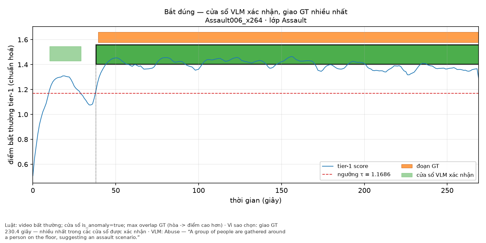
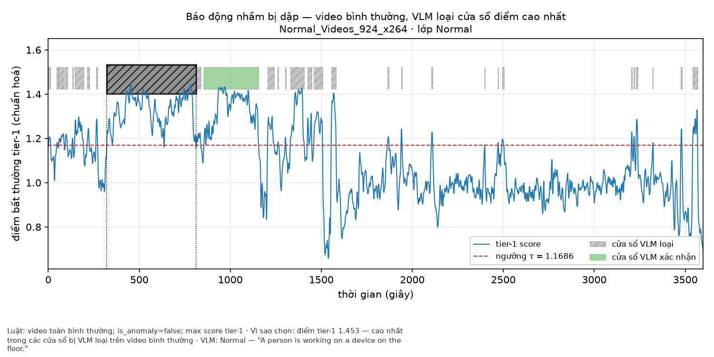
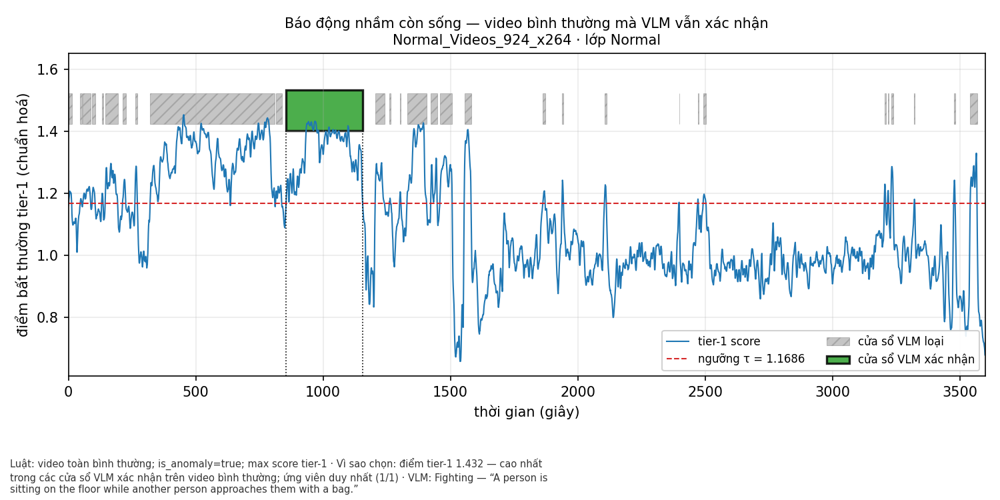
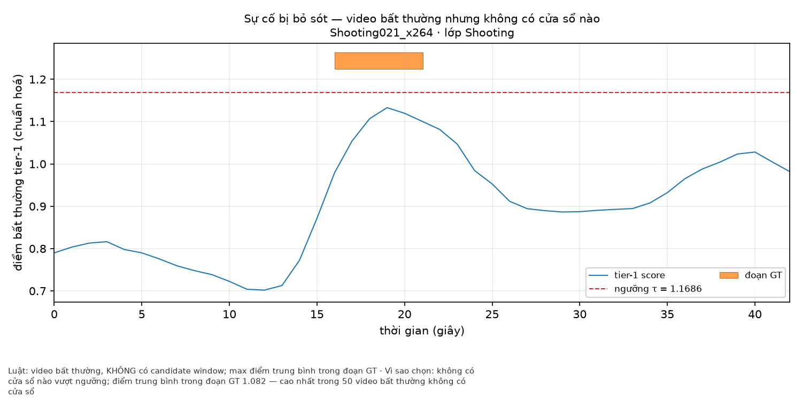
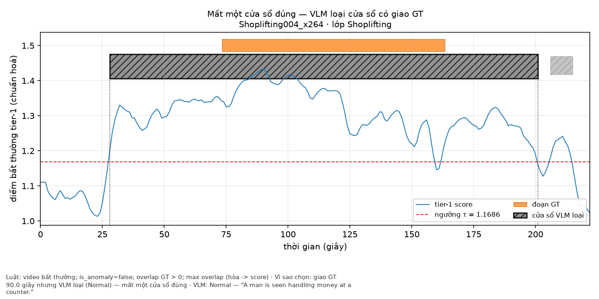

# Chương 4: Thực nghiệm và Đánh giá

## 4.1. Thiết lập thực nghiệm

### 4.1.1. Môi trường phần cứng và phân chia tính toán
Hệ thống được phát triển và kiểm thử trên các cấu hình phần cứng phân tán của các thành viên trong nhóm:
- Máy 1 (Phước): GPU NVIDIA GeForce RTX 3050 6GB VRAM (nửa chính xác float16), đảm nhiệm chạy mô hình Generative VLM (Tầng 2) và tính toán Shard 1 của bộ nhớ đệm nhúng.
- Máy 2 (Huy): GPU NVIDIA GeForce RTX 3050 4GB VRAM (float16), đảm nhiệm Shard 2 của bộ nhớ đệm nhúng.
- Máy 3 (Nam): GPU NVIDIA GeForce GTX 1060 3GB VRAM (độ chính xác đơn float32 do kiến trúc Pascal xử lý float16 chậm), đảm nhiệm Shard 3.
- Máy 4 (Thịnh): CPU nội bộ kèm môi trường đám mây Google Colab T4 16GB VRAM (dùng làm nút dự phòng và kiểm chứng chéo).

Để bảo đảm tính nhất quán giữa các máy, cơ chế chia shard sử dụng hàm băm SHA-256 trên tên video (`vad/datasets/sharding.py`). Mọi máy trạm đều dùng chung một bộ trọng số mô hình, cùng tần số trích mẫu khung hình và cùng định dạng chuẩn hóa vector.

### 4.1.2. Tập dữ liệu thực nghiệm

1. **UCF-Crime Test Split (Tập đánh giá chuẩn chính):**
   - Gồm 290 video thực tế từ camera an ninh với tổng thời lượng hàng chục giờ, độ phân giải đa dạng.
   - 140 video chứa hành vi bất thường thuộc 13 nhóm tội phạm (Abuse, Arrest, Arson, Assault, Burglary, Explosion, Fighting, RoadAccidents, Robbery, Shooting, Shoplifting, Stealing, Vandalism).
   - 150 video sinh hoạt bình thường.
   - Nhãn mặt đất (Ground Truth) được biểu diễn dưới dạng các đoạn khung hình bất thường `[start_frame, end_frame]` (chuẩn hóa ở tốc độ 30 fps) theo tệp chú thích chính thức của UCF-Crime.
2. **UCF-Crime Calib Normal (Tập hiệu chỉnh ngưỡng):**
   - Gồm khoảng 60 video bình thường lấy từ tập huấn luyện (train normal).
   - Được dùng riêng biệt để tính toán phân phối điểm nền và xác định ngưỡng báo động $\tau$ ứng với mức ngân sách báo động giả mục tiêu (ví dụ FPR = 5%, mức này là giả định chưa chốt). Tuyệt đối không chạm vào tập kiểm thử để chọn ngưỡng.
3. **ShanghaiTech Campus (Mục tiêu mở rộng - Stretch Goal):**
   - Gồm 107 video kiểm thử tại 13 góc quay khuôn viên trường đại học.
   - Nếu điều kiện thời gian cho phép, tập này được đánh giá theo quy ước "training-free kết hợp khung hình tham chiếu bình thường". Nếu thiếu thời gian, báo cáo ghi rõ giới hạn kỹ thuật này.
4. **Tập clip demo (Minh họa giao diện):**
   - Gồm 7 clip ngắn tải từ iStock (bản preview có watermark, chưa mua licence), không phải clip tự quay hay cảnh dàn dựng có consent. Nhãn thời gian được gán thủ công chỉ để đối chiếu khi demo; các clip này không tham gia bất kỳ số liệu benchmark nào.

### 4.1.3. Giao thức đánh giá (Evaluation Protocol)

- **Frame-level Micro ROC-AUC:** Điểm bất thường sau khi nội suy về tốc độ khung hình gốc (`expand_to_frames`) được nối liền thành một chuỗi nhị phân liên tục trên toàn bộ 290 video kiểm thử. Diện tích dưới đường cong ROC (ROC-AUC) được tính trên toàn bộ chuỗi khung hình này theo đúng giao thức của LAVAD (`notes/lavad-protocol.md`: gộp mọi khung hình của mọi video rồi tính một AUC, không lấy trung bình theo video). Khác biệt cần lưu ý: LAVAD lấy mẫu mỗi 16 khung rồi lặp lại điểm, còn hệ thống này lấy mẫu 1 fps rồi dùng `expand_to_frames`.
- **Khoảng tin cậy Bootstrap 95% theo Video:** Để phản ánh đúng sự biến động giữa các cảnh quay khác nhau, hệ thống thực hiện lấy mẫu lặp lại có hoàn lại 1000 lần trên cấp độ video (resampling over videos), sau đó tính khoảng tin cậy 95% CI cho ROC-AUC.
- **Điểm chuẩn cổng kiểm chứng A0 (Validity Gate):** Chạy mô hình OpenAI CLIP ViT-B/32 với hai prompt cơ sở. Kết quả phải đạt xấp xỉ mốc 53.2% (+/- 3%) được công bố bởi LAVAD để chứng minh quy trình nạp nhãn và tính toán toán học không mắc lỗi lệch khung hình (off-by-one).

## 4.2. Kết quả thực nghiệm và Phân tích thành phần (Ablation Study)

Bảng dưới đây tổng hợp tiến trình cải thiện độ chính xác qua từng thành phần thiết kế. Các ô A0 - A3 là số liệu thật (chạy trên cache embedding, 290 video, 1.111.808 khung hình; `results/ablation_A*.json`). Hàng A6 lấy từ `results/ablation_A6.json` (tầng 2 thật trên đủ 307 cửa sổ, 1000 lần bootstrap theo video; xem 4.3).

| Mã | Biến thể thực nghiệm | Kiến trúc trích xuất | Kỹ thuật áp dụng | ROC-AUC (%) | 95% Bootstrap CI | Ghi chú kỹ thuật |
|---|---|---|---|---|---|---|
| **A0** | Baseline CLIP B/32 | CLIP ViT-B/32 | 2 prompt cơ bản, chấm điểm từng khung độc lập | 48.77 | [38.30, 59.40] | Cổng tái lập mốc 53.16% của LAVAD: mốc nằm trong CI nhưng thấp hơn dải chấp nhận 50.2 - 56.2 (xem 4.2.1) |
| **A1** | SigLIP 2 đơn khung | SigLIP 2 Base | 2 prompt cơ bản, chấm điểm từng khung độc lập | 65.87 | [57.93, 73.44] | So sánh trực tiếp backbone SigLIP 2 vs CLIP (+17.1 điểm so với A0) |
| **A2** | + Prompt Ensemble | SigLIP 2 Base | Tổ hợp 4 prompt bình thường + 4 prompt bất thường | 72.39 | [64.14, 80.39] | Giảm độ nhạy với cách diễn đạt câu lệnh (+6.5 điểm so với A1) |
| **A3** | + Chuẩn hóa video | SigLIP 2 Base | Thêm `robust_normalize` (median và MAD nội tại video) | 58.99 | [54.89, 63.24] | Micro AUC GIẢM 13.4 điểm so với A2 dù macro AUC giữ nguyên 64.12 (xem 4.2.2) |
| **A4** | + Xử lý thời gian | SigLIP 2 Base | Thêm gom cụm top-k và làm mịn EMA/Median | 58.41 | [53.51, 63.42] | Macro 63.35. Micro giảm 0.6 và macro giảm 0.8 so với A3 (58.99 / 64.12), cả hai nằm trong nhiễu. Top-k và EMA chưa cứu được micro AUC bị chuẩn hóa theo video làm mất (xem 4.2.2) |
| **A5** | + Bộ nhớ cảnh tĩnh | SigLIP 2 Base | Kết hợp điểm khoảng cách Normal Memory Bank | 57.08 | [52.14, 62.28] | Macro 58.87. Memory bank từ `calib_normal` (trọng số 0.5) KHÔNG cải thiện: micro -1.3, macro -4.5 so với A4. Báo cáo trung thực là kết quả âm |
| **A3c** | A3 chuẩn hóa theo `calib_normal` | SigLIP 2 Base | Như A3 nhưng median/MAD cố định tính trên 60 video `calib_normal` (gộp khung hình) | 72.39 | [64.14, 80.39] | Bằng đúng A2: phép biến đổi affine toàn cục là đơn điệu nên không đổi AUC. Giữ được chênh lệch giữa các video (xem 4.2.2) |
| **A4c** | A4 chuẩn hóa theo `calib_normal` | SigLIP 2 Base | Như A4 với thống kê calib cố định | 73.00 | [64.45, 81.15] | Macro 63.35. Top-k và EMA cho +0.6 điểm so với A3c, nằm trong nhiễu |
| **A5c** | A5 chuẩn hóa theo `calib_normal` | SigLIP 2 Base | Như A5; thống kê memory tính leave-one-video-out trên `calib_normal` | 64.95 | [55.19, 74.61] | Macro 57.87. Memory bank vẫn làm giảm (-8.1 điểm so với A4c): kết quả âm |
| **A6** | + Thẩm định VLM | SigLIP 2 + VLM | Tầng 1 (A4/A5) + Kiểm chứng Generative VLM Tầng 2 | 67.90 | [58.39, 77.49] | Thấp hơn A4c 5.10 điểm (hiệu cặp theo video -5.10, CI 95% [-11.42, -0.25]). Tầng 2 chỉ hạ điểm các cửa sổ bị loại nên AUC chỉ có thể đổi qua 307 cửa sổ; chỉ tiêu được đăng ký trước là FA/hour và precision cửa sổ, không phải AUC (xem 4.3.2) |

### 4.2.1. Kết quả cổng kiểm chứng A0

A0 đạt 48.77% (CI 95% theo video [38.30, 59.40]), thấp hơn mốc 53.16% của LAVAD 4.4 điểm và nằm ngoài dải chấp nhận 50.2 - 56.2 đã đặt trước khi chạy. Mốc 53.16% vẫn nằm trong khoảng tin cậy. Các kiểm tra sai sót: đảo nhãn (loại trừ, một scorer đảo sẽ cho ~51), dịch nhãn ±1, ±16, +30 khung hình (AUC chỉ dao động 48.56 - 48.91, nên căn khung và quy ước biên đoạn là đúng), `logit_scale` 1/10/100 (cùng 48.77), pooling micro (macro 49.57), và prompt trùng văn bản của bài báo. Pha lấy mẫu đã kiểm tra trên cả 290 video (lấy mỗi 16 khung: 48.43 so với 48.77 ở 1 fps), không phải nguyên nhân. Chưa kiểm tra: tiền xử lý ảnh của CLIP HF so với pipeline của tác giả. Chi tiết: `notes/a0-gate.md`. Báo cáo ghi nhận đây là độ lệch so với bài báo gốc, không điều chỉnh dải chấp nhận sau khi có kết quả.

### 4.2.2. Ảnh hưởng của chuẩn hóa theo video (A2 so với A3)

Chuẩn hóa robust z-score theo từng video là phép đơn điệu trong mỗi video nên AUC theo từng video không đổi (macro 64.12 ở cả A2 và A3). Tuy nhiên micro AUC gộp khung hình giữa các video, và chuẩn hóa xóa mức chênh điểm giữa video bất thường và video bình thường, nên micro AUC giảm từ 72.39 xuống 58.99. Điều này cũng có nghĩa tỉ lệ cảnh báo sai trên giờ (FA/hour) khi dùng chuẩn hóa theo video phản ánh chính phép chuẩn hóa hơn là hệ thống, vì mọi video, kể cả video bình thường, bị ép về cùng phân phối.

**Quyết định (b): chuẩn hóa bằng thống kê cố định từ `calib_normal`.** Median và MAD của điểm được tính một lần trên toàn bộ khung hình của 60 video `calib_normal` (`PipelineConfig.norm_ref="calib"`, các biến thể A3c, A4c, A5c), rồi áp cho mọi video. Kết quả: A3c = 72.39, đúng bằng A2, như lý thuyết dự đoán (phép biến đổi affine chung cho mọi khung hình không đổi thứ hạng). Khác biệt là điểm sau chuẩn hóa có ý nghĩa tuyệt đối giữa các video, nên ngưỡng hiệu chỉnh trên `calib_normal` và FA/hour đo hệ thống thay vì đo phép chuẩn hóa. Với memory, mỗi video calib được chấm bằng bank dựng từ các video calib còn lại (leave-one-video-out), nếu không điểm memory của video nằm trong bank của chính nó bằng 0 và MAD bị đánh sập. Các biến thể chuẩn hóa theo video (A3, A4, A5) vẫn được giữ làm đối chứng.

## 4.3. Tầng 2: kiểm chứng bằng Generative VLM

### 4.3.1. Giao thức đánh giá (đăng ký trước)

- **Giao thức** nằm trong `notes/a6-protocol.md`, commit `2ed90fc` (31/10/2026 15:33 +07), trước khi lượt A5b hoàn tất (file kết quả cuối ghi lúc 18:05 +07). Lưu ý minh bạch: phiên chạy đầu của A5b đã ghi 107 cửa sổ từ 14:52 +07, tức trước thời điểm commit; theo ghi chú giao thức, người viết giao thức chưa xem verdict nào. Sau khi có số, chỉ cho phép sửa lỗi cài đặt, không đổi định nghĩa, ngưỡng $\tau$ hay luật gộp.
- **Đơn vị và verdict:** một cửa sổ ứng viên của tầng 1 (307 cửa sổ trong 114 video, đóng băng ở A4c, $\tau$ = 1.1686). Verdict chỉ lấy trường `is_anomaly` (OR trên các chunk, quy tắc D-1). Không dùng `confidence` (gần hằng số 0.95), `event_type` hay `caption` để quyết định verdict.
- **Điểm sau tầng 2:** cửa sổ bị loại có điểm hạ về 0.0 (trung vị `calib_normal`); cửa sổ được xác nhận và mọi khung ngoài cửa sổ giữ nguyên. Tầng 2 không bao giờ nâng điểm hay thêm cửa sổ, nên recall chỉ có thể giữ nguyên hoặc giảm, và AUC chỉ đổi qua 307 cửa sổ.
- **Chỉ tiêu được đăng ký trước:** tầng 2 được đánh giá bằng FA/hour và precision cửa sổ, không phải bằng AUC (`a6-protocol.md` mục 4). Nếu A6 không tăng hoặc giảm AUC thì báo cáo nguyên trạng.
- **Mô hình:** `Qwen/Qwen2.5-VL-3B-Instruct`, lượng tử hóa 4-bit nf4, $k$ = 4 khung/chunk, chunk $\le$ 30 s, `prompt_hash` = `3d71fdba`, chạy thật (`fake=false`). Không tinh chỉnh prompt (cổng D4-2: bỏ qua A6c); hàng A6 là kết quả chưa chỉnh và là kết quả chính.

### 4.3.2. Kết quả A6

Tầng 2 chạy đủ 307/307 cửa sổ, 0 lỗi: 129 cửa sổ được xác nhận (42.0%), 178 cửa sổ bị loại (58.0%). Trong video bình thường, 123/124 cửa sổ bị loại; trong video bất thường, 128/183 được xác nhận.

| Chỉ số (cùng $\tau$ = 1.1686) | Tầng 1 (A4c) | Sau tầng 2 (A6) | Thay đổi |
|---|---|---|---|
| ROC-AUC micro (%) [CI 95% theo video] | 73.00 [64.45, 81.15] | 67.90 [58.39, 77.49] | -5.10 (CI cặp [-11.42, -0.25]) |
| Cửa sổ còn lại | 307 | 129 | -178 |
| Cửa sổ trong video bình thường (báo động giả) | 124 | 1 | -123 |
| FA/hour, toàn bộ 150 video bình thường (6.01 giờ) | 20.64 | 0.17 | -99.2% |
| FA/hour, bỏ `Normal_Videos_935` và `924` (4.01 giờ) | 9.73 | 0.00 | -100% |
| Precision cửa sổ (giao nhãn mặt đất / số cửa sổ) | 28.0% (86/307) | 49.6% (64/129) | +21.6 điểm |
| Incident recall | 51.9% (81/156) | 39.7% (62/156) | -12.2 điểm |
| Độ trễ trung bình (s) | 2.03 (n = 81) | 1.74 (n = 62) | xem ghi chú |

Cách đọc:

1. **Chỉ tiêu đăng ký trước đạt:** FA/hour giảm từ 20.64 xuống 0.17 và precision cửa sổ tăng từ 28.0% lên 49.6%.
2. **Cái giá phải trả:** 22 cửa sổ bị loại giao với nhãn mặt đất (lost true positive), nên incident recall giảm từ 81 xuống 62 trên 156 sự cố. Đây là cơ chế khiến AUC giảm: hạ điểm cửa sổ giao nhãn mặt đất làm mất khung dương tính thật nhiều hơn phần khung bình thường được hạ điểm đem lại (chưa tách riêng hai phần này bằng số). Hiệu AUC cặp theo video là -5.10 với CI 95% [-11.42, -0.25], nghĩa là giảm có ý nghĩa thống kê sát biên; không được viết "tầng 2 không đổi AUC".
3. **Độ trễ không so trực tiếp được** vì tập sự cố được phát hiện đổi (81 so với 62). Trên 62 sự cố được phát hiện ở cả hai trạng thái, độ trễ trung bình tăng từ 1.19 s lên 1.74 s (trung vị đều 0.0 s).
4. **FA/hour phụ thuộc hai video dài.** `Normal_Videos_935` và `924` chứa 85/124 cửa sổ bình thường của tầng 1, nên báo cáo cả hai số. Sau tầng 2 chỉ còn 1 cửa sổ bình thường sống sót (thuộc `924`); 1 cửa sổ trên 6 giờ không đủ để ước lượng tỉ lệ báo động giả ổn định.
5. **Footnote 37 cửa sổ tự mâu thuẫn.** Có 37/307 cửa sổ VLM trả `is_anomaly=false` nhưng `event_type` khác `Normal`. Theo quy tắc đăng ký trước, verdict chỉ lấy `is_anomaly`, nên 37 cửa sổ này tính là bị loại. Phân tích hậu nghiệm (không thuộc kết quả chính): nếu đảo cả 37 thành xác nhận thì precision là 47.6% (79 TP / 87 FP) so với 49.6% (64 / 65) và thêm 3 báo động giả ở video bình thường, nên việc đảo không có lợi rõ ràng.
6. **Kết quả VLM không tái lập 100%:** pilot chạy lại 10 cửa sổ giống 9/10 verdict so với A5b (`Arrest030_x264[1]` đổi từ `false` sang `true`), nguyên nhân chưa xác định (khác phiên bản thư viện hoặc giải mã không tất định).

### 4.3.3. Kiểm tay 20 cửa sổ (A6b)

Mẫu 20 cửa sổ phân tầng (10 được xác nhận, 10 bị loại) được rút trước khi xem verdict (`notes/a6-handcheck-sample.csv`). Người chấm xem 12 khung hình mỗi cửa sổ, không thấy verdict hay mô tả của VLM, nhãn được commit trước khi mở khóa (`notes/a6-handcheck.md`).

| VLM \ Người chấm | bất thường | bình thường | không chắc |
|---|---:|---:|---:|
| Xác nhận | 6 | 4 | 0 |
| Bị loại | 0 | 9 | 1 |

- Precision của cửa sổ được xác nhận trên mẫu là **6/10 = 60%** (Wilson 95%: 31.3 - 83.2%). Đây là độ chính xác do người đánh giá, khác với precision theo giao nhãn mặt đất ở 4.3.2 (một cửa sổ có sự cố thật nhưng nằm ngoài đoạn chú thích UCF vẫn được tính đúng ở đây). Mẫu chỉ có 1 cửa sổ xác nhận ở video bình thường nên con số này không thể thay cho precision theo trọng số của toàn bộ 129 cửa sổ (ước lượng khoảng 66%, CI rất rộng).
- Mẫu **không kiểm tra được bỏ sót**: không có false negative trong 9 cửa sổ bị loại đã được quyết định, nhưng 22/178 cửa sổ bị loại thật sự giao nhãn mặt đất và chỉ 3/10 cửa sổ bị loại của mẫu thuộc video bất thường. Không được trích "VLM không bỏ sót".
- Rủi ro quan sát được trong mẫu là **xác nhận thừa** (4 false positive, toàn bộ là bằng chứng yếu: cửa sổ rất ngắn 1 - 4 s hoặc rất dài 301 s).
- Giới hạn: người chấm đồng thời là tác giả bộ rút mẫu và người chạy VLM, nên tính độc lập là kỷ luật chứ không phải cơ chế; `video_id` lộ lớp video.

### 4.3.4. Phân tích lỗi và hình minh họa

Các trường hợp được chọn bằng luật trong `scripts/make_figures.py` (không chọn bằng mắt), mỗi hình có đường $\tau$, đoạn nhãn mặt đất và các cửa sổ tô màu theo verdict:

| Hình | Loại | Video | Ý nghĩa |
|---|---|---|---|
|  | Xác nhận đúng | `Assault006_x264` | Cửa sổ 38 - 270 s giao nhãn mặt đất 230.4 s, được VLM xác nhận |
|  | Báo động giả bị loại | `Normal_Videos_924_x264` | Cửa sổ có điểm tầng 1 cao nhất trên video bình thường (1.453) bị VLM loại |
|  | Báo động giả còn sống | `Normal_Videos_924_x264` | Cửa sổ duy nhất còn lại (855 - 1156 s) |
|  | Bỏ sót ở tầng 1 | `Shooting021_x264` | Không cửa sổ nào vượt $\tau$, tầng 2 không cứu được |
|  | Mất cửa sổ đúng | `Shoplifting004_x264` | Cửa sổ 28 - 201 s giao nhãn mặt đất 90 s bị VLM loại |

Các nguyên nhân lặp (`notes/a7-fp-analysis.md`; phân tích đọc từ JSON, chưa xem khung hình, nên chỉ là suy luận từ mô tả):

- **Mâu thuẫn `event_type` và verdict:** 15/22 cửa sổ mất nhãn đúng có `event_type` khác `Normal` (ví dụ `Arrest`, `Fighting`) dù `is_anomaly=false`.
- **Hành vi nhỏ trong cửa sổ dài:** với cửa sổ 173 s, 24 khung cho khoảng 1 khung mỗi 7 s, một hành vi ngắn có thể rơi giữa hai khung (`Shoplifting004`, `Stealing062`).
- **Luật OR trên chunk:** báo động giả sống sót duy nhất (`Normal_Videos_924_x264`, 11 chunk) bị xác nhận vì đúng 1 chunk trả `true` còn 10 chunk trả `Normal`. Cửa sổ càng dài càng dễ có một chunk bắn sai; sửa prompt không xử lý được cơ chế này.

### 4.3.5. Định danh sự kiện (Event Typing)

Khác với tác vụ phát hiện nhị phân, việc gán nhãn 13 lớp được đo riêng. Ba phép đo dưới đây có đơn vị và mẫu khác nhau, **không đặt cạnh nhau như cùng một thước đo**.

| Phương pháp | Đơn vị và mẫu | Top-1 | KTC 95% (theo video) | Mức đoán mò |
|---|---|---|---|---|
| Zero-shot Text Typer, strict (C3) | 156 đoạn nhãn mặt đất, 140 video bất thường | 40.4% (63/156) | - | 7.69% (1/13) |
| Zero-shot Text Typer, lenient (C3) | như trên, gộp nhóm tên gần nghĩa | 50.0% (78/156) | - | 7.69% |
| Zero-shot Text Typer (C7e) | 62 cửa sổ do VLM xác nhận và giao nhãn mặt đất, 56 video | 24.2% (15/62) | [14.1, 35.6] | 7.69%; luôn đoán `Shooting`: 25.8% |
| Generative VLM Typing (C7e) | cùng 62 cửa sổ | 83.9% (52/62) | [74.6, 92.8] | 7.69%; luôn đoán `Shooting`: 25.8% |

Lưu ý khi đọc (`notes/2026-11-01-c7e-vlm-typing.md`):

1. **Mẫu C7e có điều kiện và lệch lớp:** chỉ gồm cửa sổ VLM đã tự xác nhận bất thường và có giao nhãn mặt đất; `Shooting`, `Explosion`, `Burglary`, `Arson` chiếm 45/62 = 73%. Không suy ra "VLM gọi tên đúng 84% mọi sự cố UCF".
2. **VLM làm bài chọn đóng:** prompt liệt kê sẵn 13 tên lớp cộng `Normal` (không chứa nhãn của video nên không rò rỉ nhãn, nhưng phải gọi là closed-set).
3. **Typer không hơn đoán theo lớp phổ biến nhất trên mẫu này:** KTC 95% của typer [14.1, 35.6] phủ mức 25.8%, còn KTC của VLM tách hẳn khỏi mức đó. Trên cùng 62 cửa sổ, VLM đúng và typer sai ở 37 ca, typer đúng và VLM sai ở 0 ca.
4. **Hướng nhầm của VLM** (10 ca sai): 6/10 bị gọi là `Robbery` (chủ yếu `Shooting`), 3/10 là `Explosion`, 1/10 là `Shoplifting`.
5. **Quyết định D-2:** nhãn của cảnh báo do typer quyết định, không do `event_type` của VLM. Lý do là tính tất định và tái lập (13 câu cố định, cùng không gian nhúng với tầng 1, không đổi khi thay mô hình VLM), **không** phải vì typer chính xác hơn; trên mẫu này VLM gọi tên tốt hơn. Hạn chế này được nêu ở mục 5.2.

## 4.4. Các chỉ số vận hành thực tế (Operational Metrics)

Để đánh giá mức độ khả thi khi triển khai hệ thống vào trung tâm điều hành camera thực tế, hệ thống đo lường các chỉ số vận hành tại ngưỡng $\tau$ được hiệu chỉnh trên tập `calib_normal` (ngưỡng tương ứng ngân sách FPR = 5%):

1. **Báo động giả mỗi giờ (False Alarms per Hour - FA/hour):**
   Số lượng cảnh báo sai phát sinh trên mỗi giờ video hoàn toàn bình thường từ tập kiểm thử:
   $$\text{FA/hour} = \frac{\text{Tổng số lần phát cảnh báo sai trên video bình thường}}{\text{Tổng thời lượng video bình thường (giờ)}}$$
2. **Độ trễ phát hiện (Detection Latency):**
   Khoảng thời gian tính bằng giây từ thời điểm bắt đầu xảy ra sự kiện bất thường theo nhãn mặt đất ($t_{GT\_start}$) đến thời điểm hệ thống phát ra cảnh báo đầu tiên ($t_{alert}$):
   $$\text{Latency} = \max(0, t_{alert} - t_{GT\_start})$$
3. **Tỉ lệ bao phủ sự cố (Incident-level Recall):**
   Tỉ lệ phần trăm các sự kiện thực tế có ít nhất một cảnh báo chính xác rơi vào khoảng thời gian xảy ra sự cố.

Ngưỡng $\tau$ = 1.1686 chọn bằng phân vị 95% của điểm A4c gộp trên 60 video `calib_normal` (`scripts/calibrate_threshold.py`, `results/threshold_A4c.json`), FPR đạt được trên calib là 4.99%. Trên các khung hình bình thường của tập test, cùng ngưỡng cho FPR 10.57%, gấp đôi ngân sách: `calib_normal` lấy từ tập huấn luyện nên khác camera và cảnh so với tập test (lệch phân phối), không phải lỗi tính toán. Bảng dưới báo cáo cả hai trạng thái, tầng 1 (A4c) và sau tầng 2 (A6), vì tầng 2 chỉ có thể loại bớt cửa sổ: nó giảm FA/hour nhưng không tăng recall (số liệu từ `results/ablation_A6.json`, xem 4.3.2).

| Chỉ số vận hành | Ngưỡng hiệu chỉnh $\tau$ (tại FPR calib = 5%) | Tầng 1 (A4c) | Sau tầng 2 (A6) | Đơn vị tính | Nguồn đo kiểm |
|---|---|---|---|---|---|
| Báo động giả mỗi giờ (FA/hour), toàn bộ | 1.1686 | 20.64 (124 cửa sổ / 6.01 giờ) | 0.17 (1 cửa sổ / 6.01 giờ) | sự cố / giờ | 150 video bình thường tập test |
| Báo động giả mỗi giờ, bỏ `Normal_Videos_935` và `924` | 1.1686 | 9.73 (39 / 4.01 giờ) | 0.00 (0 / 4.01 giờ) | sự cố / giờ | Số thứ hai, báo cáo kèm số đầy đủ |
| Precision cửa sổ (giao nhãn mặt đất) | 1.1686 | 28.0 (86/307) | 49.6 (64/129) | % | Cửa sổ trong video bình thường luôn là dương tính giả |
| Độ trễ phát hiện trung bình (Mean Latency) | 1.1686 | 2.03 (n = 81; trung vị 0.0) | 1.74 (n = 62; trung vị 0.0) | giây | 140 video bất thường; trên 62 sự cố chung: 1.19 so với 1.74 |
| Tỉ lệ phát hiện sự cố (Incident Recall) | 1.1686 | 51.9 (81/156) | 39.7 (62/156) | % | Cửa sổ cảnh báo giao với nhãn mặt đất |
| Video có cửa sổ lên Tầng 2 | 1.1686 | - | 39.3 (114/290) | % số video | Mọi cửa sổ ứng viên đều lên tầng 2 nên mẫu số là video, không phải cửa sổ |
| Mật độ cửa sổ ứng viên | 1.1686 | - | 1.06 (307/290) | cửa sổ / video | Tải đẩy lên VLM; 65 cửa sổ (21.2%) bị chia chunk, 480 lượt gọi VLM |
| Thời gian xử lý mỗi cửa sổ VLM | - | - | median 3.71; p90 14.41 | giây / cửa sổ | Qwen2.5-VL-3B 4-bit; tổng 51.7 phút cho 307 cửa sổ (bản chạy A5b) |
| Peak VRAM | - | - | 2.91 (nvidia-smi); 2.52 (torch allocated) | GB | Pilot 10 cửa sổ trên RTX 3050 6GB, không phải lượt 307 cửa sổ |

Ghi chú cho bảng cost (`notes/a5b-log.md`):

- Tổng thời gian có một cửa sổ ngoại lệ 457 s (`Explosion017_x264[0]`, nhiều khả năng là nghẽn đọc video); trừ ngoại lệ còn 44.1 phút. Tốc độ lệch khoảng 3 lần giữa hai phiên chạy (median 9.73 s so với 3.23 s mỗi cửa sổ) không do cấu hình khác nhau và chưa xác định được nguyên nhân, nên số liệu báo cáo là số gộp 307 cửa sổ.
- Peak VRAM không được ghi trong lượt 307 cửa sổ; số trên lấy từ pilot chạy lại cùng cấu hình sản xuất, khớp với benchmark A1 trên T4 (2.52 GB torch, 2.93 GB thiết bị).
- 46/307 cửa sổ chưa dùng khung đã kẹp biên video (PR #35) nên chunk và verdict không đổi nhưng chi tiết khung có thể lệch tối đa 0.93 s ở các cửa sổ này.
